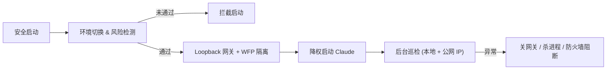

<div align="center">

# Claude Guard

**面向 Windows 的 Claude Desktop 环境隔离与断流守护工具**


</div>

---

## 核心功能

- **一键环境切换**：在 **美国模式**（`Pacific Standard Time` + `en-US` + Clash `Global` / TUN）与 **中国模式**（`China Standard Time` + `zh-CN` + Clash `Rule` / 系统代理）间自动切换与回滚。
- **启动前风险检测**：启动前自动核验出口 IP、信任评分、地区支持、IP 属性、安全标记、DNS 泄露、UDP（STUN）与设备时区/语言一致性；支持自动绑定基准 IP 或手动锁定固定 IPv4。
- **本机网关与 WFP 隔离**：检测通过后建立专用 Loopback HTTP 网关，并通过原生 Windows Filtering Platform（WFP）限制已识别的 Claude 可执行路径仅经该网关出站，随后降权启动 Claude Desktop。
- **运行期断流保护（Kill Switch）**：独立后台守护持续巡检本地环境与代理公网出口，检测到 IP 漂移、TUN 关闭、节点或时区变更时，立即关闭网关、终止进程树并启用防火墙出站阻断（`ClaudeGuard_Block`）。



---

## 环境要求

- **Windows 10 / 11**（需管理员权限以配置 WFP、防火墙及系统时区/策略）
- **Python 3.10+**
- **Clash Verge**（需开启本机控制接口及全局快捷键）
- **Claude Desktop**

---

## 快速开始

```powershell
git clone https://github.com/leishufei/claude-guard.git
cd claude-guard
pip install -r requirements.txt
python main.py
```

首次使用时，打开右上角 **`节点与 IP 设置`**，刷新并选择目标 Clash 节点后保存即可（配置保存在 `%LOCALAPPDATA%\ClaudeGuard\settings.json`）。

> 常用启动参数：`--preview`（仅预览界面）、`--tray-startup`（静默托盘启动）、`--exit`（退出后台实例）。

---

## 打包、快捷方式与测试

```powershell
# 运行测试并打包单文件 EXE (输出至 dist\ClaudeGuard.exe，需安装 pyinstaller)
.\scripts\build.ps1

# 创建桌面快捷方式
.\scripts\create-shortcut.ps1

# 单独运行单元测试
python -B -m unittest discover -s tests -p "test_*.py"
```

---

## 目录结构

```text
ClaudeGuard/
├── main.py              # 启动入口
├── requirements.txt     # 运行依赖
├── src/                 # 源码（UI、Clash/Edge 控制、WFP 隔离、网关与守护）
├── assets/              # 应用图标与内置字体
├── scripts/             # 打包与快捷方式脚本
└── tests/               # 单元测试
```

---

## 安全边界与许可

- WFP 隔离作用于启动时已发现的 Claude Desktop 可执行文件路径，不保证覆盖共享 MCP 解释器、跨账户服务、Cowork 虚拟机或升级后新路径。
- 公网巡检受网络延迟影响，不构成内核级硬实时保证；STUN 探针仅作辅助提示。
- 基于 [MIT License](LICENSE) 开源，仅供个人网络环境管理与学习参考。
